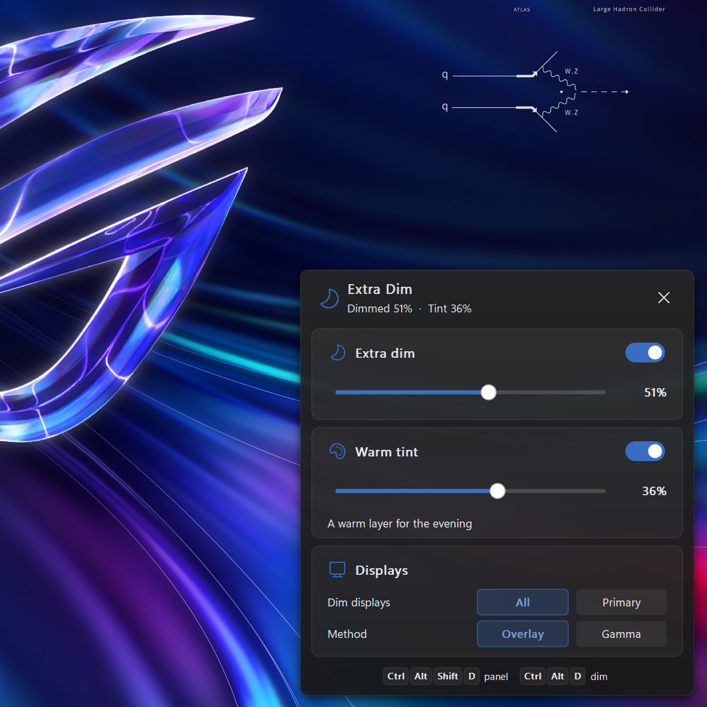

# Extra Dim

A [Windhawk](https://windhawk.net/) mod for Windows that dims the screen past the
bottom of the brightness slider, and adds a warm tint for the evening.

Open it with **Ctrl+Alt+Shift+D**, or click the tray icon. Everything in the panel
is also in that icon's right-click menu.

## Features

| Feature | What it does |
| --- | --- |
| Extra dim | Dims below the 0% brightness Windows stops at. The slider tops out at the ceiling you set, so the screen can't go fully black by accident. Switching it off keeps the level. |
| Overlay method | A click-through black layer over each display. Works with any GPU and driver, doesn't touch HDR, and costs nothing while it's off. No effect in exclusive-fullscreen games. |
| Gamma method | Lowers the display's own gamma ramp instead, which does reach exclusive fullscreen. Depends on the driver. |
| Automatic fallback | If the driver refuses the gamma ramp, the mod notices and goes back to the overlay, and the Displays card says so instead of claiming gamma. |
| Warm tint | A separate warm layer with its own color and strength. Stacks with dimming or runs alone. Its strength stays visible in the panel while the tint is off. |
| All displays or one | Dim every monitor or only the primary. Each monitor gets its own layer, so adding or removing one doesn't break it. |
| Out of captures | Screenshots, recordings and screen sharing stay at normal brightness. Overlay method only. |
| Dimmed pointer | Off by default. Windows draws the pointer above every window, so under the overlay it is swapped for a darkened copy while dimming is on, and put back when it stops. |
| Fluent panel | Per-pixel surface, Segoe UI Variable and Segoe Fluent Icons, Windows' theme and accent or ones you pin yourself. |
| Tray icon | Click to open or close the panel, right-click for the controls. The tooltip shows the levels. Redrawn in your accent, and put back if Explorer restarts. |
| Hotkeys | Open the panel, toggle the dim, toggle the tint, dim more, dim less. Every chord can be changed or cleared. |
| Remembers | Levels, toggles, method and display choice survive a restart. |

## Settings

| Setting | Default | Notes |
| --- | --- | --- |
| Start with extra dim on | Off | Applies the start level as soon as the mod loads. |
| Extra dim level on start | 40% | Also the level the toggle restores. |
| Remember changes | On | When off, the startup values win every time. |
| Theme | Follow Windows | Or force Light or Dark. |
| Accent color | Windows accent | Nine presets, or a color of your own. |
| Panel opacity | 96% | The plate only; text and controls stay opaque. |
| Panel scale | 100% | On top of the monitor's own DPI scaling. |
| Screen position | Right | Nine anchors, kept inside the work area. |
| Target monitor | Pointer | Or always the primary display. |
| Horizontal / vertical offset | 0 px | Fine placement. |
| Close when the panel loses focus | On | Behaves like a shell flyout. |
| Show a tray icon | On | Keeps the notification-area icon while the mod is loaded. |
| Default dim level | 40% | What the Extra dim toggle restores. |
| Step | 10% | One wheel notch, arrow key or hotkey press. |
| Maximum dim level | 90% | Ceiling for the slider. At 100% the screen is nearly black. |
| Dimming method | Overlay | Overlay or Gamma; the Displays card can change it too. |
| Dim every display | On | All monitors, or only the primary. |
| Leave the layer out of screen captures | On | Overlay method only. |
| Keep the panel above the dim layer | Off | Off dims the panel along with the rest of the screen. |
| Smooth level changes | On | Glides between levels instead of jumping. |
| Dim the mouse pointer too | Off | Overlay method only; Gamma dims the pointer already. The system cursors are swapped while dimming is on. |
| Warm tint color | `#FFB56B` | Color of the warm layer. |
| Starting tint strength | 0% | What the Warm tint toggle restores. |
| Shortcuts | `ctrl+alt+shift+d`, `ctrl+alt+d`, `ctrl+alt+t`, `ctrl+alt+up`, `ctrl+alt+down` | Written the way they're pressed. Empty disables one. A chord needs Ctrl, Alt, Shift or Win; a lone key is ignored unless it's an F-key. |

## Requirements

- Windows 10 or Windows 11.
- [Windhawk](https://windhawk.net/) installed and running.

## Install

1. In Windhawk, open **Mods** and click **Create new mod**.
2. Set the id to `extra-dim`, replace the template with all of
   `extra-dim.wh.cpp`, and click **Compile mod**.
3. Switch the mod on. The tray icon appears, and **Ctrl+Alt+Shift+D** opens the
   panel.

It's a tool mod, so it runs in its own `windhawk.exe` process rather than inside
Explorer. Nothing here can take the shell down.

## Limits

- **Overlay doesn't reach exclusive fullscreen.** Those games bypass the desktop,
  so there's nothing to draw over. Use Gamma there.
- **Gamma is the driver's call.** If `SetDeviceGammaRamp` is refused, the mod
  returns to the overlay instead of leaving the screen untouched. Choosing Gamma
  in the panel asks the driver again.
- **The secure desktop stays bright.** Windows doesn't run third-party windows on
  the UAC prompt or the sign-in screen.
- **Pointer dimming swaps the system cursors.** If the process is killed rather
  than unloaded, they stay dark until you sign out or pick a cursor scheme in
  Mouse settings. That's why the option is off by default.

## How it works

- **Panel** - a per-pixel-alpha layered window painted in software: 32-bit
  premultiplied DIB, signed-distance rounded rectangles, ClearType blended per
  channel. Every measurement is a logical unit times the monitor's DPI and the
  panel scale.
- **Dim layer** - one `WS_EX_LAYERED | WS_EX_TRANSPARENT | WS_EX_TOPMOST` window
  per display, filled with a single color and given a single alpha, re-raised by
  a slow watchdog.
- **Gamma** - a DC per display, the current ramp saved, and exactly that ramp put
  back on the way out, so a calibrated display returns as it was.
- **Tint** - its own layered window with its own color and strength.
- **Pointer** - each system cursor is rebuilt by hand from its own color and mask
  bitmaps, darkened by the same amount as the layer, then swapped in; gamma needs
  none of it, because the pointer rides on the scanout.
- **Tray icon** - drawn with GDI at four times the size and averaged down, which
  antialiases it and gives the shell the coverage a 32-bit icon expects.

## State

`HKCU\Software\DpakB\ExtraDim`, and nothing else. The mod doesn't read or write
Windows' Night light setting, and sends nothing anywhere.

## License

MIT.
